<div align="center">

<picture>
  <source media="(prefers-color-scheme: dark)" srcset="./cards/hero-dark.svg">
  
</picture>

[](https://github.com/m-afham)
[](https://mafham.dev)
[](https://stackoverflow.com/users/8451247/m-afham?tab=profile)
[](mailto:m.afham.work@gmail.com)
[](https://www.linkedin.com/in/m-afham)

<a href="https://mafham.dev"><picture><source media="(prefers-color-scheme: dark)" srcset="./cards/tile-apps-dark.svg"></picture></a>
<a href="https://www.linkedin.com/in/m-afham"><picture><source media="(prefers-color-scheme: dark)" srcset="./cards/tile-years-dark.svg"></picture></a>
<a href="https://github.com/m-afham?tab=repositories"><picture><source media="(prefers-color-scheme: dark)" srcset="./cards/tile-repos-dark.svg"></picture></a>

</div>

## Featured

<a href="https://github.com/m-afham/AirCursor"><picture>
  <source media="(prefers-color-scheme: dark)" srcset="./cards/spotlight-dark.svg">
  
</picture></a>

<p align="center">
  <a href="https://github.com/m-afham/AirCursor/releases/latest/download/AirCursor.zip"></a>
</p>

## More work

<a href="https://github.com/m-afham/Twinly"><picture><source media="(prefers-color-scheme: dark)" srcset="./cards/repo-twinly-dark.svg"></picture></a>
<a href="https://github.com/m-afham/SmartSim"><picture><source media="(prefers-color-scheme: dark)" srcset="./cards/repo-smartsim-dark.svg"></picture></a>
<a href="https://github.com/m-afham/SwiftCleanCode"><picture><source media="(prefers-color-scheme: dark)" srcset="./cards/repo-swiftcleancode-dark.svg"></picture></a>
<a href="https://github.com/m-afham/SensorMotionEffect"><picture><source media="(prefers-color-scheme: dark)" srcset="./cards/repo-sensormotioneffect-dark.svg"></picture></a>
<a href="https://github.com/m-afham/InstagramStoryView"><picture><source media="(prefers-color-scheme: dark)" srcset="./cards/repo-instagramstoryview-dark.svg"></picture></a>
<a href="https://github.com/m-afham/SmileToUnlock"><picture><source media="(prefers-color-scheme: dark)" srcset="./cards/repo-smiletounlock-dark.svg"></picture></a>

<picture>
  <source media="(prefers-color-scheme: dark)" srcset="./cards/activity-dark.svg">
  
</picture>

---

## About Me

I'm a passionate Lead iOS Engineer specializing in iOS and macOS application development, with extensive experience in building scalable mobile solutions. Based in Pakistan, I focus on creating exceptional user experiences through clean code and modern development practices — increasingly with AI as a force multiplier across the whole workflow.

| | Current Focus |
|---|---|
| **Role** | Lead iOS Engineer, contributing to both frontend and backend mobile application development |
| **Learning** | Test-Driven Development (TDD), Combine Framework, SwiftUI, and modern iOS architectures |
| **Continuous Growth** | Regularly consuming tech content, writing technical articles, and staying current with industry trends |
| **Passion** | Building apps that users love and that follow Apple's Human Interface Guidelines |
| **AI-native** | Shipping faster by pairing with Claude Code, and building on-device intelligence into apps |
| **Writing** | Field notes on iOS craft at [mafham.dev/blog](https://mafham.dev/blog) |

## Technical Stack

**Languages & Frameworks** &nbsp;


**AI & Developer Tooling** &nbsp;


**Apple Development Tools** &nbsp;


**Design & Version Control** &nbsp;


**Cloud & Backend Services** &nbsp;


**Collaboration & Project Management** &nbsp;


## Writing

I write about the last 10% — the details that separate working from great.

<!-- BLOG-POST-LIST:START -->
- [Clean Architecture, interactively](https://mafham.dev/blog/clean-architecture.html)
- [UIKit & SwiftUI interview questions that actually come up](https://mafham.dev/blog/ios-interview-questions-uikit-swiftui.html)
- [17 ways to debug UIKit](https://mafham.dev/blog/uikit-debugging-guide.html)
- [Top 5 iOS logging & diagnostics libraries](https://mafham.dev/blog/ios-logging-libraries.html)
- [Top 5 iOS animation libraries](https://mafham.dev/blog/ios-animation-libraries.html)
<!-- BLOG-POST-LIST:END -->

**→ More at [mafham.dev/blog](https://mafham.dev/blog)**

## Core Expertise

<details>
<summary><b>iOS & macOS Development</b></summary>

- Native iOS applications using Swift and modern frameworks
- macOS desktop applications leveraging AppKit and SwiftUI
- Universal apps that work seamlessly across Apple devices
- Apple Watch and iPad app development
</details>

<details>
<summary><b>Architecture & Design Patterns</b></summary>

- MVVM, VIPER, and Clean Architecture implementations
- Protocol-oriented programming and dependency injection
- Reactive programming with Combine framework
- Design patterns for scalable and maintainable codebases
</details>

<details>
<summary><b>Quality & Performance</b></summary>

- Test-Driven Development (TDD) and comprehensive unit testing
- UI testing and snapshot testing for robust applications
- Performance optimization and memory management
- App Store optimization and submission processes
</details>

<details>
<summary><b>Modern iOS Technologies</b></summary>

- SwiftUI for declarative user interfaces
- Async/await for concurrent programming
- WidgetKit for home screen widgets
- On-device AI with Core ML and Apple Intelligence
</details>

<details>
<summary><b>AI-Assisted Engineering</b></summary>

- Building with Claude Code: architecture, refactors, tests, and tooling
- LLM-driven code review, documentation, and rapid prototyping
- Integrating machine learning features into shipping apps
</details>

<details>
<summary><b>Integration & APIs</b></summary>

- RESTful APIs and GraphQL integration
- Real-time data synchronization
- Third-party SDK integration
- Backend services and cloud platforms
</details>

## What I Build

```swift
struct DeveloperProfile {
    let name = "Muhammad Afham"
    let title = "Lead iOS Developer"

    let skills = [
        "iOS Development",
        "macOS Applications",
        "SwiftUI & UIKit",
        "Architecture Design",
        "AI-Assisted Engineering"
    ]

    func buildExceptionalApps() -> UserExperience {
        return .outstanding   // shipped faster, with Claude Code
    }
}
```

## Let's Connect

Always happy to talk iOS architecture, accessibility, AI-assisted development, or the craft of shipping polished apps. Whether you want architecture advice, a mock interview, or to collaborate — reach out.

<div align="center">

[](https://topmate.io/m_afham)
[](https://www.buymeacoffee.com/mafham)

<br>

*"Building the future of mobile experiences, one commit at a time."*

**Available for contractual projects and consulting opportunities**

</div>
